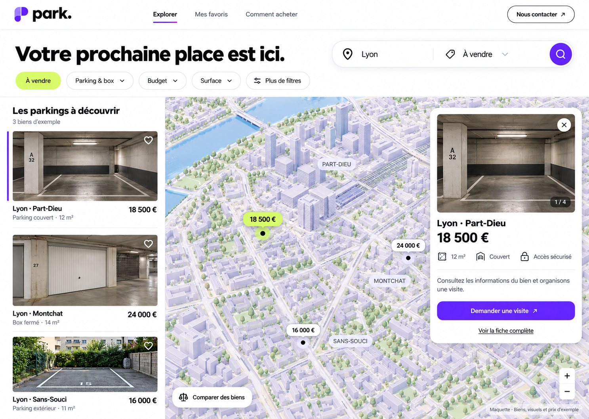
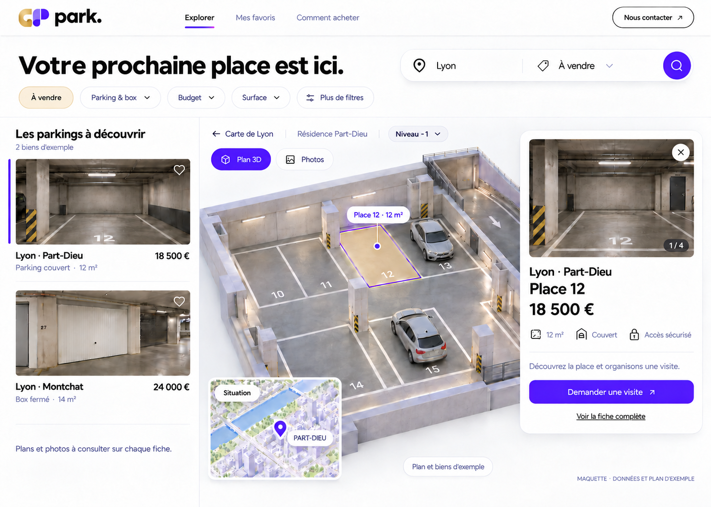
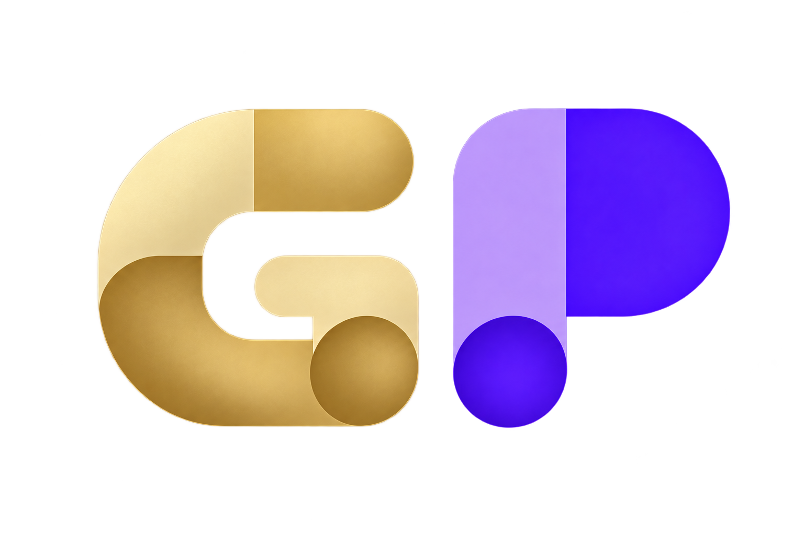

# GP — dossier de construction de la plateforme de parkings

Version 1.1 · 20 octobre 2026 · langue de lancement : français · pays de départ : France.

**Livrable de conception : cahier des charges, charte, contrats de données et ordre de développement. Aucun site, compte externe, abonnement ou paiement n’est créé par ce dossier.** « GP » est un nom de travail et un monogramme proposé, pas une marque déclarée disponible.

## Le produit à construire

Une plateforme de petites annonces spécialisée dans la vente de parkings et de box. Mathis peut publier ses biens ; d’autres utilisateurs peuvent créer un compte et déposer leurs annonces. Les acheteurs explorent une carte de ville en 3D, consultent les photos et, lorsqu’un modèle fidèle est disponible, sélectionnent les places dans une vue 3D du parking.

**V1 : dépôt gratuit. V2 : forfaits mensuels récurrents.** L’exemple de 5 €/mois donné par Mathis sert à préparer la structure, sans arrêter le tarif ni les quotas. Aucun paiement à l’annonce et aucun paiement du prix immobilier dans la plateforme.

La présentation adoptée est **claire et blanche, violet vif, avec doré doux pour les sélections**, fidèle aux deux dernières maquettes retenues. Les essais de site entièrement noir/or ne sont plus la référence. Le dernier ajustement garde le doré sur la place et l’utilise très pâle sur le filtre actif. Le logo validé visuellement est le **G doré devant le P violet du fichier joint par Mathis** ; ses formes et couleurs ne sont plus à modifier. Le filtre actif est champagne pâle et la place sélectionnée reçoit un voile doré discret. La police principale choisie pour réaliser cette direction est Inter ; la police d’une image générée ne peut pas être identifiée avec certitude.

## Ouvrir le dossier

- [Dossier complet en lecture HTML](Dossier-complet.html)
- [Charte visuelle et exemples de composants](Charte-visuelle.html)
- [Rapport de vérification documentaire](VERIFICATION.md)

## Lire le dossier

| Document | Ce qu’il tranche |
|---|---|
| [01 — Produit et parcours](01_PRODUIT_ET_PARCOURS.md) | Périmètre, rôles, pages, navigation, états et parcours complets |
| [02 — Charte visuelle](02_CHARTE_VISUELLE.md) | Police, tailles, graisses, couleurs, espacements, composants, mobile, animations et logo GP |
| [03 — Annonces et qualité](03_ANNONCES_ET_QUALITE.md) | Dépôt guidé, champs, lot/place, photos, qualité réelle et règles de publication |
| [04 — Cartes et 3D](04_CARTES_ET_3D.md) | Carte gratuite, sélection des bâtiments, modèle intérieur, fidélité, formats et préparation des relevés |
| [05 — Architecture, données et API](05_ARCHITECTURE_DONNEES_API.md) | Stack, tables, index, interfaces serveur, révisions et concurrence |
| [06 — Comptes, sécurité et modération](06_COMPTES_SECURITE_MODERATION.md) | Authentification, autorisations, fichiers, messagerie, confidentialité et administration |
| [07 — Abonnements V2](07_ABONNEMENTS_V2.md) | Forfaits, droits, renouvellement, résiliation, impayés et migration depuis la gratuité |
| [08 — Développement, recette et exploitation](08_PLAN_DEV_RECETTE_EXPLOITATION.md) | Étapes de construction, tests, livraison, sauvegardes, métriques et budgets |
| [09 — Décisions et sources](09_DECISIONS_ET_SOURCES.md) | Choix retenus, points ouverts non bloquants, sources officielles et limites des références |
| [10 — Équipe et délégation](10_EQUIPE_ET_DELEGATION.md) | 18 rôles spécialisés, missions, fichiers, dépendances et vagues de travail |
| [Index des briefs](agents/README.md) | Consignes prêtes à transmettre à chaque spécialiste |
| [Spécification des tokens](specs/design-tokens.json) | Valeurs structurées à reprendre dans le thème du futur code |
| [Schéma d’un niveau 3D](specs/parking-level.schema.json) | Contrat des plans, unités, géométrie et preuves de fidélité |
| [Backlog](specs/backlog.csv) | Tâches ordonnées et critères de fin |

## Références visuelles

La vue ville conserve la structure de la maquette initiale (ses anciens accents citron sont historiques). La vue parking ci-dessous reprend la dernière demande : sélection dorée douce et filtre actif champagne pâle. Le fichier de tokens définit la palette courante pour les deux vues.

Les deux fichiers suivants sont les maquettes de référence et restent des illustrations de démonstration, pas des photos de biens de Mathis ni des captures d’une application fonctionnelle.

## Décisions qui évitent de recoder

1. Une annonce n’est pas une place physique : une annonce peut regrouper plusieurs places avec un prix total explicite.
2. Un seul compte peut acheter et publier ; les pouvoirs de modération sont attribués séparément.
3. Les mises à jour d’une annonce publiée passent par une nouvelle révision ; elles ne remplacent pas instantanément une version approuvée.
4. Un parking partage son modèle entre ses places, mais un vendeur ne peut pas modifier les données d’un autre vendeur.
5. Les scènes 3D sont versionnées et reliées à des identifiants stables ; prix et disponibilité viennent de la base, jamais du fichier 3D.
6. L’interface utilise une police, sept tailles de texte et des composants réutilisables. Les valeurs libres sont proscrites hors exceptions documentées.
7. L’état réel du parking reste visible. Une mesure inconnue est enregistrée comme inconnue, jamais comme zéro ou comme absence de défaut.
8. L’accès gratuit et les futurs abonnements utilisent le même calcul de droits côté serveur ; Stripe reste absent de la V1 publique.
9. Un acheteur peut comprendre une annonce sans WebGL : liste, fiche et photos restent disponibles.
10. Le logo et le nom restent provisoires jusqu’à une vérification de disponibilité ; une génération d’image ne prouve aucune exclusivité.

## Logo et dernière direction

Les essais de métal réaliste et d’or désaturé ont été écartés : revenir à la couleur du premier G doré et conserver un rendu lisse, cohérent avec le P. Le nom de travail et le signe restent à vérifier avant usage commercial. La source de chaque proposition est indiquée dans `assets/LOGO_PROMPTS.md`.

## Pour lancer le développement

Les 18 rôles sont préparés ; seuls trois agents de relecture/organisation ont été lancés pendant la conception. Le développement se déroulera par vagues de trois spécialistes au maximum avec un coordinateur dans cette session.

Commencer par le jalon M0 du document 08 : verrouiller les tokens et les contrats, préparer les données de démonstration et collecter un parking pilote réel. Ensuite développer une tranche complète : compte → brouillon → modération → publication → recherche → contact. La carte et la vue intérieure s’appuient sur ce flux au lieu de constituer un prototype isolé.

Le premier vrai parking 3D nécessite un plan, des dimensions et des photos. En leur absence, le développement logiciel avance avec des fixtures clairement étiquetées, mais la fidélité d’un modèle réel ne peut pas être annoncée comme acquise.
