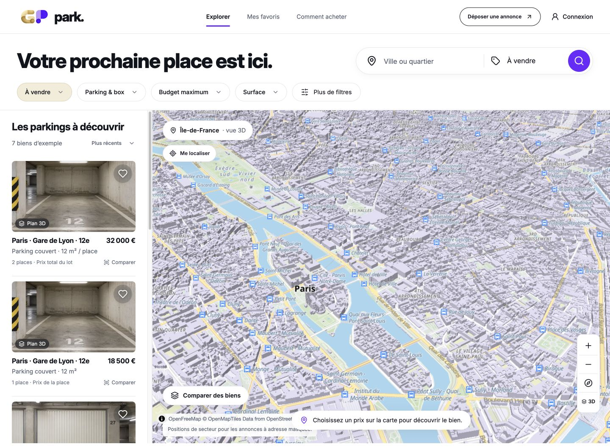
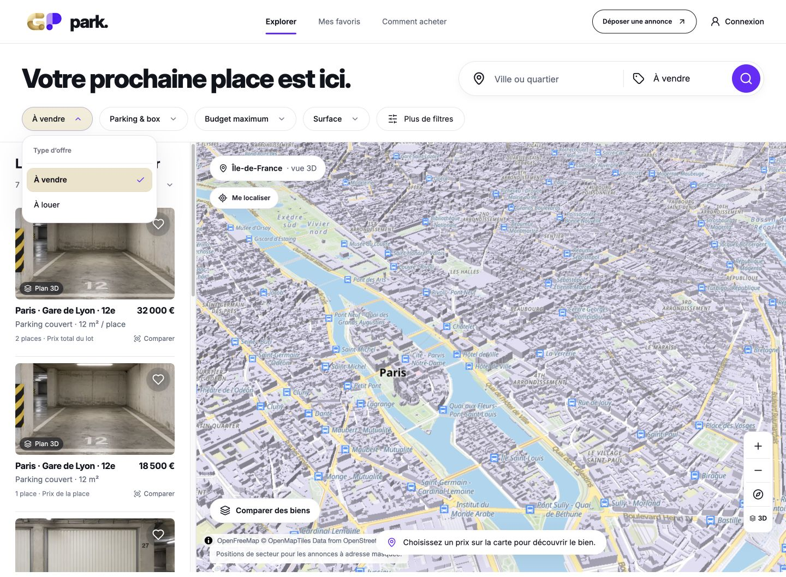
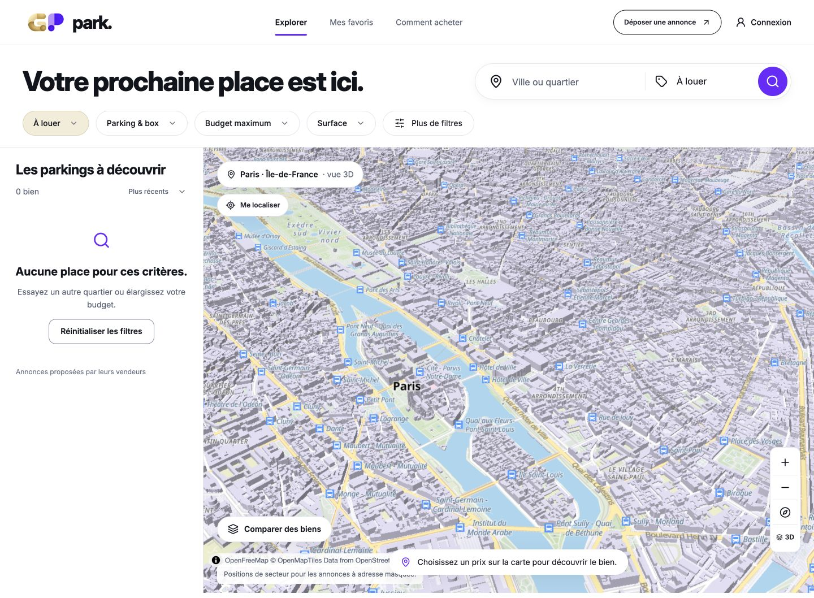
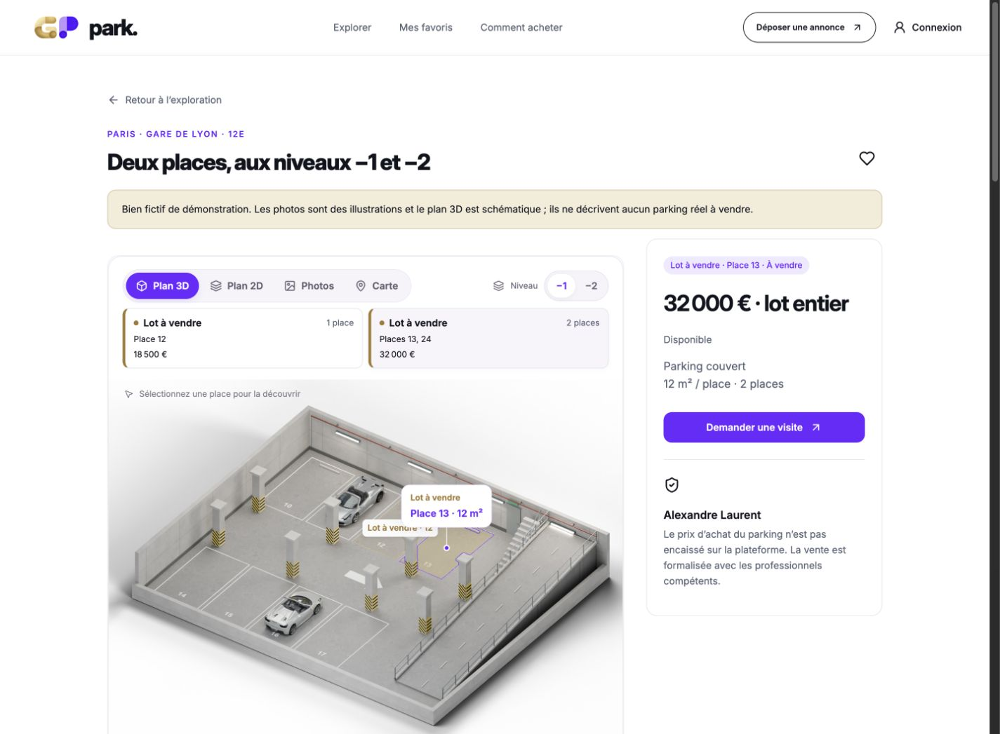
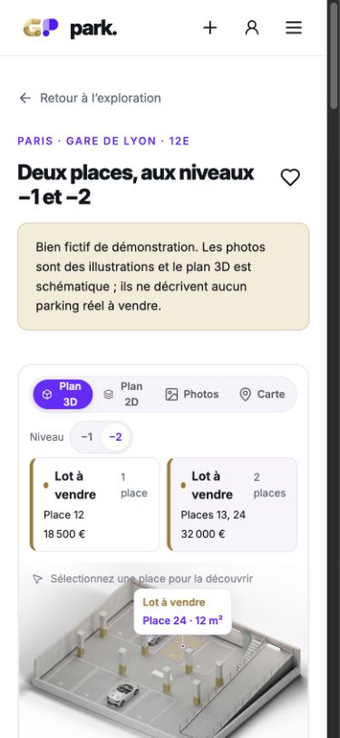
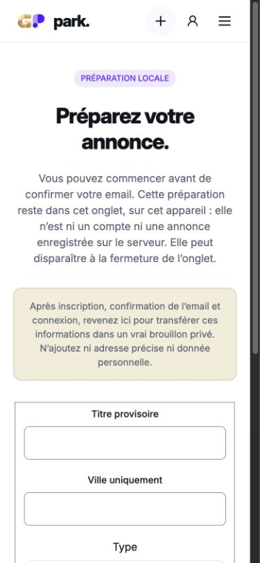
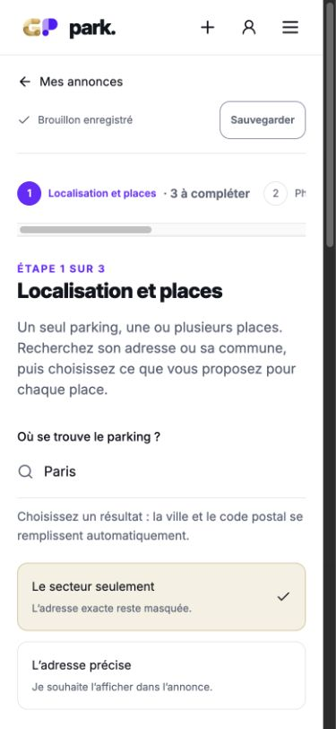
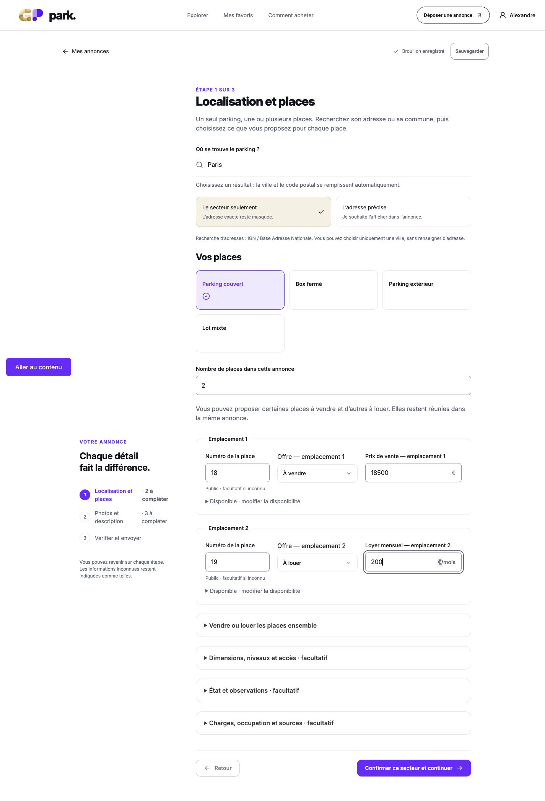
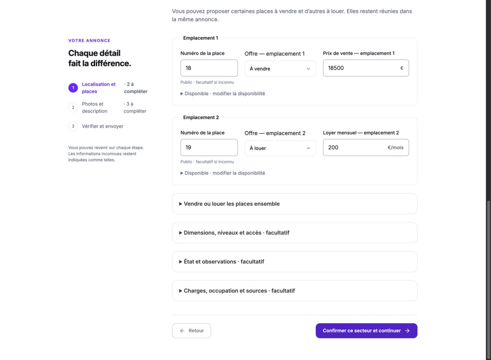
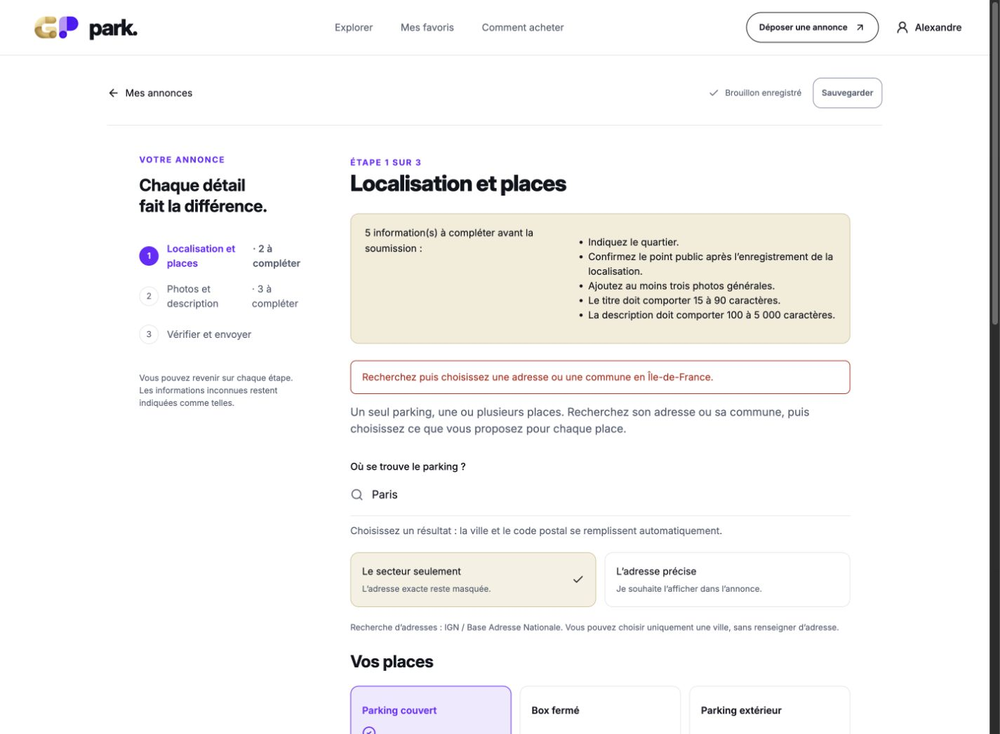

# Revue de cohérence et d’ergonomie — 22 octobre 2026

**Verdict : base fonctionnelle et cohérente sur les principaux scénarios, finition V1 non achevée.** Cette revue directe révèle des corrections UX encore utiles ; elle ne certifie ni tous les cas ni une ouverture publique.

## Périmètre et méthode

Revue actuelle dans IAB du build `pcMqwObi9XdoC2NB2C0vG`, code de `b039978`, en production locale sur SQLite jetable,1 440 px et390 px. Les empreintes des fichiers source correspondent à `resume-delivery.json`. Captures nouvelles de cette revue uniquement, enregistrées et inspectées ; les captures transitoires de chargement ont été remplacées après stabilisation. Données et compte vendeur de démonstration exclusivement. Aucun accès ou changement Supabase, email humain, purge CDN, publication ou déploiement public.

## Corrections à traiter

1. **Prioritaire : erreurs du dépôt.** À l’échec de l’étape 1, guider vers l’erreur visible et limiter le détail à cette étape. Éviter les erreurs de photos/titre avant l’étape correspondante. Preuves 09/10 et observation DOM ci-dessous.
2. **État vide de recherche.** Adapter le conseil de la carte et ne proposer une remise à zéro que si elle peut modifier les critères. Preuve 03 et clic réellement sans changement visible.
3. **Entrée vendeur anonyme.** Raccourcir les explications et rendre le choix de compte plus direct. Preuve 06 ; appréciation ergonomique, pas panne fonctionnelle.
4. **Cadrage de carte.** Aider à retrouver les annonces lorsque la caméra affichée ne montre aucun prix. Preuve 01 ; ne pas conclure à une absence de marqueur d’après ce seul cadrage.

## 1. Exploration — fonctionnement observé satisfaisant

Liste, prix, surface par place, prix du lot et carte en volume sont visibles. Dans le cadrage observé, les prix ne sont pas visibles sur la portion de carte affichée : prévoir une action explicite pour recadrer sur les résultats, sans écraser la caméra manuelle. Ce constat est une friction de la vue observée, pas une preuve que les marqueurs sont absents.

## 2. Choix vente/location — satisfaisant

Menu personnalisé lisible ; passage à « À louer » observé, avec mise à jour de l’URL et de la recherche. Cette revue ne constitue pas un test complet du clavier ou du lecteur d’écran.

## 3. Aucun résultat — cohérence à corriger

Le message d’absence de résultat et les0 bien sont corrects. La carte conserve « Choisissez un prix sur la carte » alors qu’aucune offre ne reste. Avec la seule location active, « Réinitialiser les filtres » conserve ce choix et n’a aucun effet visible. Conserver l’intention de location est raisonnable, mais ce bouton ne devrait pas sembler promettre un rétablissement des résultats quand aucun critère ne peut être retiré.

## 4. Annonce et parking — satisfaisant dans le scénario

Le lot de deux places affiche32 000 € pour le lot entier. Les deux lots sont distingués par leurs numéros et prix. Le choix−2 affiche bien la place 24 ; le plan reste visible sur mobile. Le contact est dans l’annonce. Les photos, la carte intérieure, l’envoi d’un message, tous les lots et tous les scénarios de navigation ne sont pas rejoués ici.

## 5. Dépôt sans compte — entrée trop dense

Sur390 px, les explications de préparation locale occupent la majeure partie du premier écran ; les actions de création/connexion se trouvent plus bas. La limite de conservation locale mérite d’être expliquée, mais plus brièvement, avec l’action principale plus visible. Ce constat ne demande pas de retirer les informations utiles à la décision.

## 6. Dépôt connecté et offres mixtes — satisfaisant dans le scénario

Connexion via le vendeur fictif local, puis création d’un brouillon privé. Deux places 18 et 19 dans une annonce :18 à vendre 18 500 €,19 à louer 200 €/mois. Les champs et unités de prix restent distincts ; les options avancées sont repliées. La capture 08 est pleine page et peut présenter la navigation collante à une position liée au défilement ; elle sert à lire les offres, pas à juger cette position.

## 7. Validation incomplète — correction prioritaire

Sans résultat de localisation choisi, « Continuer » reste à l’étape 1 : le garde fonctionne. Mais le focus reste sur le bouton en bas et les erreurs apparaissent hors écran, plus haut. DOM observé : lien « Ajoutez au moins trois photos générales » ày = −914,10 px pour un viewport de 1 058 px. Le résumé comporte aussi les photos, le titre et la description de l’étape 2. Afficher les erreurs de l’étape actuelle, puis placer le focus et la vue sur l’explication utile. Le résumé global peut rester à la vérification finale.

## Limites et reste du plan

Cette revue ne rejoue pas la publication/modération, les messages, visites, suspensions, conflits concurrents, tous les formulaires, lecteur d’écran, zoom 200 %, réseau lent ou restauration opérationnelle. Ces cas ne sont pas déclarés bons d’après les images. Aucun test avec des utilisateurs représentatifs n’a été mené pour prouver qu’ils comprennent le parcours sans aide.

Les preuves techniques déjà enregistrées correspondent au code inchangé :194 tests dont 191 réussis et 3 conditionnels ignorés ; parcours HTTP local 176/176 ; campagne Supabase 224/225. Ces résultats sont relus dans les rapports, pas réexécutés dans cet audit. L’unique échec connecté reste la réponse photo CDN antérieure après retrait ; la clé et la purge réelle restent différées par le propriétaire. Les apports réels de parking, compte humain/MFA, emails reçus, identité opérateur et exploitation/sauvegarde/restauration restent à valider avant ouverture. Le worker externe de rétention et le cycle d’archive complet n’ont pas été prouvés par cette revue.

Les forfaits/paiements sont en V2. Rendu intérieur, logo et palette approuvés préservés. Aucun code produit modifié par cette revue.

## Nettoyage

Le brouillon et les sessions de cette revue n’existaient que dans un runtime SQLite dédié, supprimé après arrêt du serveur. Onglet temporaire fermé et viewport restauré. Aucun serveur de cette revue ne demeure ouvert.
